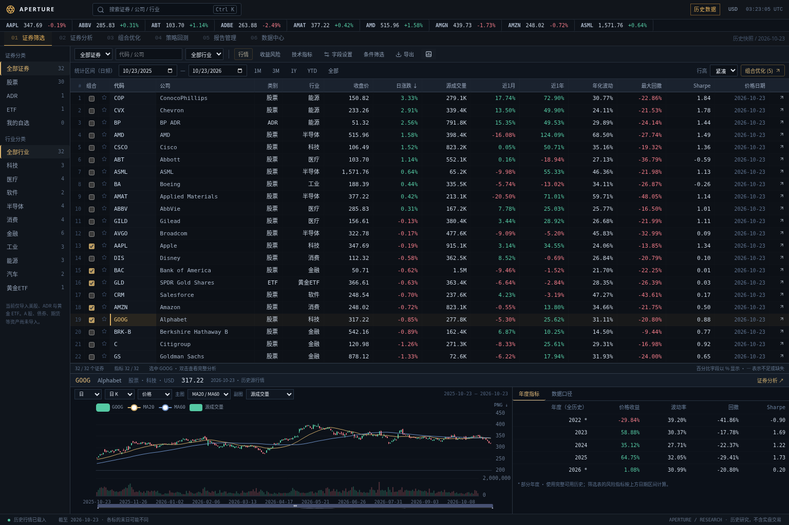

# APERTURE · 金融研究终端

基于用户真实美股分钟行情的课程软件：检索与自选 → 个股年度指标与比较 → 五模型量化分析 → 滚动样本外回测 → 保存、导出研究报告。

## 已实现

- **证券筛选**：股票/ADR/ETF、行业、自选、数值条件；20项可选指标列、顺序、排序、紧凑行高和浏览器保存显示配置。
- **曲线与指标**：年/月/日/5分钟/2分钟/1分钟切换，价格、累计收益、回撤、滚动波动；MA、BOLL、MACD、RSI、成交量；缩放、悬浮与PNG下载。
- **证券分析**：双证券共同日期比较、年度行情指标、收益分布、数据质量。
- **组合优化**：等权、最小方差、均值—方差、MVSK、风险平价；权重约束、相关性与收敛信息。
- **策略回测**：滚动窗口、信号延迟、权重漂移与交易成本；对照净值、回撤、调仓审计和CSV。
- **数据中心**：历史OHLCV分页查询、单只/多只/组合成分CSV或JSON下载、可选技术指标、来源审计、API与OpenAPI。
- **账户与权限**：注册、登录、角色授权、会话撤销、修改密码；每个用户独立保存自选和报告。
- **报告管理**：PostgreSQL保存完整参数和结果，查询、删除、JSON/Markdown导出与打印。
- 清楚区分加载、错误、空数据、计算中、就绪、求解失败回退；支持手机布局。

[下载 APERTURE.zip](https://github.com/linzhefeng24/Applepie/raw/refs/heads/main/downloads/APERTURE.zip)（不包含原 C++ 工程和课件）。



## 一个命令启动

只需要下载本项目目录，进入该目录的终端运行：

```bash
bash run.sh
```

也可以在任意目录指定脚本位置执行，例如 `bash "/你自己的目录/financial-terminal/run.sh"`。脚本自动定位项目，不要求目录必须叫 financial-terminal 或放在固定位置。

正式下载包包含预编译 Scala 后端及其依赖。第一次会自动安装其余项目依赖、初始化本地数据库、构建前端并启动全部服务；正常启动不下载 sbt 或 Maven 依赖。以后运行同一命令会复用已安装依赖；依赖清单、项目位置或源码变化时会重新安装或构建。启动成功后打印浏览器访问地址，默认端口 4173。无需自己分别启动数据库和多个微服务。

```bash
bash run.sh stop       # 停止本项目应用及项目管理的数据库，保留数据
bash run.sh restart    # 重启
bash run.sh setup      # 强制刷新依赖、重新构建并启动
bash run.sh help       # 查看说明
```

服务在后台运行，关闭当前终端后仍继续运行。日志位于 `.run/`，安装失败会显示原因，不会误报启动成功。自选和报告保存在本地 PostgreSQL 中；重复启动不清空这些记录。

### 自动准备基础环境

在 Ubuntu 22.04/24.04/26.04（包括 Windows WSL）和 Debian 13 中，直接运行 `bash run.sh`。缺少基础工具时会自动处理：

- Java 21 和 PostgreSQL：本次安装使用隔离的发行版官方源与索引，保留发行版签名校验；不会读取或修改系统中的 Docker、NodeSource 等第三方源。
- Node：版本不足 24 时，从 Node 官方下载并校验 SHA256，安装到项目 `.tools/runtimes/`，不替换系统 Node。
- Python：版本不在 3.12–3.13 范围时，通过固定版本 uv 安装项目专用 Python，不替换系统 Python；通过原生 uv 创建环境和安装依赖，不调用旧 pip；损坏的项目环境会保留在同级备份后重建。

安装系统包时可能提示 **sudo 密码**，输入你的 Linux 用户密码即可。请使用普通用户执行 `bash run.sh`，**不要使用 `sudo bash run.sh`**；PostgreSQL 不能以 root 运行。首次安装需要联网；如果没有 sudo 权限，脚本会说明缺少的权限，不能跳过系统权限要求。

Scala 业务代码运行在 JVM 上，sbt 编译也需要 Java，因此安装 Java 是 Scala 工具链的一部分，并不要求编写 Java。

在 WSL 中，如果项目位于 `/mnt/c`、`/mnt/d` 等 Windows 盘，默认会将 PostgreSQL 数据放在 Linux 用户的状态目录，并在私有状态目录中保留凭据，避免 Windows 文件权限导致数据库启动失败。已有 `.env` 中明确设置的 `PG_DATA_DIR` 会优先使用。

使用已有数据库时可在 `.env` 设置 `MANAGE_POSTGRES=false` 和各服务的 `<SERVICE>_DB_*` 连接信息，自动安装逻辑会跳过 PostgreSQL 系统包。机器已有符合版本的工具时直接复用。不会修改你的 shell 配置文件或替换系统的 Node/Python。

配置优先级是环境变量 > `.env` > `config/defaults.json`。首次管理本地数据库时为八个独立实例生成不同口令，保存在状态目录的 0600 credentials.json 中；没有外部付费 API 密钥要求。

### 开发与检查

需要单独操作时仍可使用原有脚本：

```bash
bash scripts/setup.sh              # 安装和构建
bash scripts/start-services.sh     # 只启动服务
bash scripts/build-backend.sh      # 只编译 Scala
npm --prefix frontend run dev     # 前端热更新，默认 5173
npm --prefix frontend run build   # 前端生产构建
```

源码下载不包含运行中的进程、数据库口令或依赖缓存；首次运行将创建这些本地状态。发布云环境快照后恢复时，也需要重新执行启动命令。

## 服务与数据归属

17 个 Scala 服务分别构建和启动，两个 Python 数值 worker 分别处理优化与回测。八个持久化服务各有独立 PostgreSQL 实例、应用角色与口令；无状态服务只通过 HTTP 获取数据。账户、会话、权限独立，自选和报告按用户隔离。完整清单、默认端口与单服务发布方式见 [服务架构](docs/ARCHITECTURE.md)。

[架构与课程要求对照](docs/COURSE-ALIGNMENT.md) · [原始实施计划](docs/PLAN.md) · [数据与指标口径](docs/DATA-AND-METHODS.md) · [验证记录](docs/VALIDATION.md)

## 数据说明

用户 Release `data_v1` 的 `part1.zip` 已完整下载并匹配发布 SHA256；选取其中 32 个跨行业股票/ADR/黄金 ETF，将约 1,300 万条源分钟记录简化为 **37,247 条日线**，覆盖 **2022-03-07 至 2026-10-23**。原始 ZIP 被忽略，不进入源代码包；可直接从已保存的 CSV 重建数据库。

- [日线 CSV](data/daily.csv)、[股票资料](data/stocks.json)、[逐股审计与来源](data/provenance.json) 已保留。
- `part2.zip`、`part3.zip` 没有导入。当前支持查询的是已导入的 32 个标的，不能声称覆盖整个美股市场。
- **没有财报、复权说明和分红数据**。PE、PB、ROE 等显示“未提供”；本软件的“历年指标”首先是行情与收益风险指标。
- 不能把分钟来源成交量当作全市场成交量，不能把未确认复权的价格收益当作总收益。

重新从原始包生成：

```bash
python3 scripts/run-python.py scripts/prepare_data.py --archive data/raw/part1.zip
python3 scripts/check-data.py
```

## 验证命令

服务启动后：

```bash
OPENBLAS_NUM_THREADS=1 python3 scripts/run-python.py -m unittest discover -s quant/tests -v
OPENBLAS_NUM_THREADS=1 python3 scripts/run-python.py scripts/verify-api.py
npm --prefix frontend run typecheck
npm --prefix frontend run build
cd frontend && npm run test:e2e
```

浏览器测试使用系统 Chromium；其他机器可以设置 `CHROMIUM_PATH`。测试会暂时写入自选/报告并清理，建议在开发数据库运行。界面截图位于 [docs/screenshots](docs/screenshots)。

## 范围

这是可运行的课程研究软件。没有实盘交易、自动行情更新、全市场因子数据、真实财报或账户系统。高阶矩优化为样本估计，MVSK 非凸，多起点求解不保证全局最优。请用回测和审计数据讨论方法，不以某次历史表现作为投资结论。

## 目录与连接配置

项目可以解压到任意可写目录（包括带空格的目录）。上述 `cd financial-terminal` 是相对于解压目录的示例；请按自己的位置进入项目，而非创建 `/workspace`。脚本根据自身位置定位项目，数据路径相对于项目根目录解析。

默认值统一放在 `config/defaults.json`。可复制 `.env.example` 为 `.env`，只填写需要覆盖的项；优先级为 **进程环境变量 > .env > 默认值**。数据库口令不会进入 Git。服务、前端及验证脚本读取同一份配置。

```bash
# 从项目目录启动，并临时覆盖端口（也可以写入 .env）
MARKET_PORT=8201 WATCHLIST_PORT=8202 OPTIMIZATION_PORT=8203 QUANT_PORT=8204 BACKTEST_PORT=8205 HISTORY_PORT=8206 STATISTICS_PORT=8207 REPORTS_PORT=8208 FRONTEND_PORT=4273 bash scripts/start-services.sh
```

可配置 `DATA_DIR`、`PG_DATA_DIR`、`PG_BIN`、`PG_SHARE`、`PG_SOCKET_DIR`、`DB_HOST/PORT/NAME/USER/PASSWORD`、各服务端口与 `MARKET_URL/QUANT_URL`。端口是可覆盖的默认值，不是必须占用的固定端口。更改运行服务的配置前，先使用原配置停止进程。

已有 PostgreSQL：在 `.env` 设置 `MANAGE_POSTGRES=false` 和数据库连接信息，提前建立空数据库并授予表创建权限；脚本将验证连接，且不会启动、停止或初始化外部 PostgreSQL。需要非默认 PostgreSQL 安装位置时设置 `PG_BIN`；启动脚本自动定位已下载包内的可执行文件，不绑定版本目录。

搬移已经安装过的项目之前先停止服务。启动时会检查 Java classpath 的生成位置，位置变化或依赖失效时自动重建；这类绝对路径只存在于忽略的运行缓存。Python 虚拟环境本身不保证可搬移。WSL 中位于 `/mnt/c`、`/mnt/d` 等 Windows 盘的项目，会自动将工具放入 Linux 用户目录 `~/.local/share/aperture/runtimes`，将 Python 环境放入 `~/.cache/aperture/venvs`；重复解压的相同依赖版本可以复用这些缓存。可通过 `APERTURE_RUNTIME_DIR`、`APERTURE_VENV_DIR` 覆盖位置。

浏览器测试优先使用 `CHROMIUM_PATH`，其次搜索 PATH，最后使用 Playwright 自己安装的 Chromium，不依赖 `/usr/bin/chromium`。

### 系统已有第三方源报错

如果系统中 Docker 等源缺少签名公钥，普通 `apt update` 可能失败。APERTURE 安装器为本次安装准备临时的官方源配置与独立索引，update 和 install 都使用同一份配置；官方仓库仍须通过系统 keyring 验签，未关闭任何签名检查。

这不会修复或改写你的 Docker 源；系统原有第三方源保持原样。APERTURE 不依赖 Docker，可独立安装。WSL 的 localhost 代理提示属于另一项网络配置，不能把它与软件源签名错误混为一谈。

### 全局 pip / npm 指向无法访问的私有源

项目安装使用独立的软件源，不修改用户的 pip.conf、pip.ini 或 npmrc。默认 Python 源为 PyPI 官方 HTTPS，npm 为官方 HTTPS registry；全局 Nexus 私有源、额外 Python 索引和安装目标设置不会带入项目安装。TLS 校验保持开启，并保留显式的证书和代理环境设置。

如果确需自己的镜像，可在 `.env` 设置 `APERTURE_PYPI_INDEX_URL` 和 `APERTURE_NPM_REGISTRY`（只接受 HTTPS）。uv 引导工具和全部 Python 依赖都通过同一个项目安装入口下载，避免引导成功后又在另一个阶段使用旧的全局源。

### npm 安装完成后暂时没有新输出

接下来是首次 Scala/sbt 构建，可能需要下载 Maven 依赖。新版会实时显示构建日志，并每 20 秒报告进程仍在运行；安装分为六个有明确标记的阶段。长时间等待时，应查看日志判断是否有下载或网络错误，不能只凭没有命令提示符断言构建正常。

旧版安装已经在运行时，不需要重新安装；在另一个终端进入同一项目目录后运行 `tail -n 40 .run/compile.log` 查看最新内容，或 `tail -f .run/compile.log` 持续观察。结束观察用 Ctrl+C；这只停止该终端的 tail，不会停止原终端的构建。

### Maven 仓库连接超时

正式发布的 `APERTURE.zip` 自带 `backend/runtime/`，其中17 个业务 JAR、两个共享基础库及第三方依赖都有 SHA256 清单。脚本校验包内容与 Scala 源码指纹后，直接生成当前目录的 Java 类路径，跳过 sbt/Maven 下载；这是同一份 Scala 后端的预编译运行包，完整源码仍在。

GitHub 自动生成的源码 ZIP、普通 Git 克隆不包含生成的运行包，开发者需要自行源码构建。Scala 源码变更后也会要求重建，损坏的运行包会停止使用，不会放宽校验。

```bash
# 开发者明确从源码构建（需要访问 Maven）
APERTURE_BUILD_FROM_SOURCE=1 bash scripts/setup.sh
# 提交源码后，生成后端发布运行包，再打包独立 ZIP
python3 scripts/backend-runtime.py pack
python3 scripts/package-release.py
```

如果旧版本卡在 `getting org.scala-sbt sbt`，先查看 `.run/compile.log`。出现 Maven `Connection timed out` 时，可使用含运行包的正式下载 ZIP 覆盖代码；保留 `.env`、`.venv`、`.tools` 和数据库。新版普通启动不会重新走 sbt 下载。

Python 引导直接下载并校验原生 uv 工具，通过 uv 创建环境和安装依赖，不调用旧环境的 pip。旧 `uv-bootstrap` 即使缺少 `pip._vendor.packaging` 也不会阻塞启动；损坏的项目 Python 环境会保留备份后重建，依赖导入失败会自动重装一次。


## 服务与课程规范

17 个独立 Scala 服务加两个 Python 数值服务，各自端口、日志、路由和消息文件。业务 API 采用 Cats Effect IO，数据库事务仅在所属服务的 Table 中执行，无状态编排不持有数据库连接。详见 [课程与示例对照](docs/COURSE-ALIGNMENT.md)、[API](docs/API.md)、[功能范围与参考](docs/FEATURES.md)。

本次服务拆分需要使用完整安装包，旧启动小补丁不适用于新拓扑。升级前在旧目录 `bash run.sh stop`，然后将完整包解压到干净目录启动，避免残留旧源码参与运行包指纹校验。WSL 工具与 Python 依赖缓存仍可复用。


## 分钟数据与频率选择

完整包新增32证券最近60个交易日的真实分钟输入，约70.9万条，压缩约8MB；保留全时段日线，月/年线用完整日线聚合。默认分钟范围2026-07-31至2026-10-23，日线范围2022-03-07至2026-10-23；各证券具体可用起止时间以界面/API为准。

首页联动图、证券分析和数据中心均可选年/月/日/5分钟/2分钟/1分钟。年线仅在至少三个完整公历年度可用时出现。查询上限5000根/证券，超限提示缩小区间。默认分钟图显示末7个自然日，数据中心可自定区间与下载相应频率。缺失分钟不补齐，时区未确认，不伪造交易所时区或跨日合成。

如需这32证券的全部分钟历史（原始清洗后共13239858条，数据库占用会显著增加），先下载原始 part1.zip，再在项目目录执行：

```bash
bash run.sh stop
python3 scripts/run-python.py scripts/prepare_minutes.py --archive "/你的数据目录/part1.zip" --all
bash run.sh
```

也可用 `--sessions 120` 只保留最近120个记录交易日。脚本验证原始包SHA256，生成确定性的压缩输入；历史服务按清单校验和增量判断是否需要重新导入。导入在事务中进行，失败不会留下半批分钟记录。默认完整安装包始终是60个交易日子集，不包含用户另外扩展的全历史。

分钟价格、成交量等用于真实频率图表/下载；已有组合优化与回测仍明确采用日频，避免混用252期年化。

## 独立服务与用户隔离

现为 **19 个服务、17 个独立 Scala 发布 JAR、8 个独立 PostgreSQL 实例**。第一次打开页面先创建管理员账户；后续注册默认为分析员，无默认密码。详见 [服务部署与边界](docs/ARCHITECTURE.md)、[账户权限](docs/SECURITY.md)、[课程示例对照](docs/COURSE-ALIGNMENT.md)。旧匿名报告需明确指定归属后迁移，启动器不会擅自分配。

## 第二次作业与演示录像

现有10个独立功能页面：证券筛选、证券分析、证券对比、组合风险分析、组合优化、策略回测、报告管理、数据中心、数据质量审计、账户管理，登录/注册另计。新增页面支持共同日期曲线对比、风险贡献/VaR/ES/相关性、自定义权重和数据来源审计。

本人录制视频的准备事项、约2分50秒逐页操作顺序和100M附件检查见 [演示录制脚本](docs/DEMO-RECORDING.md)。
