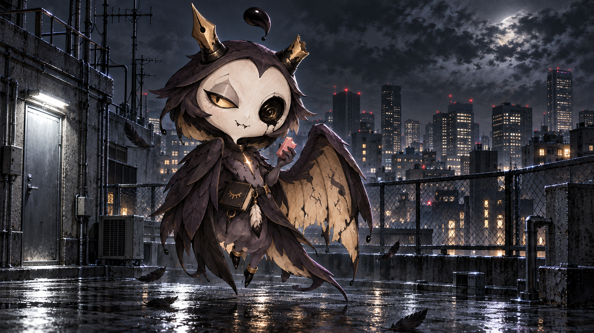
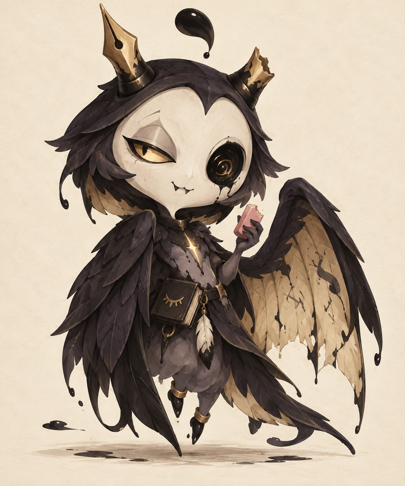
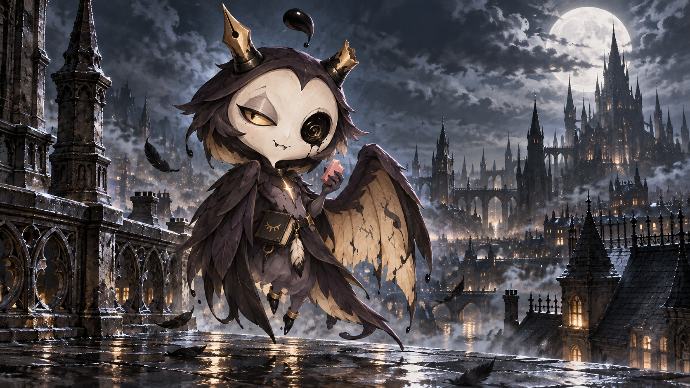

# 墨鸦 · Ink Raven

原创卡通死神角色的第一版概念图。

## 当前版本：现代都市楼顶

现代日本城市夜景，铁丝围栏、空调外机、天线与雨后楼顶。保留角色形象，用冷色调和强烈明暗对比营造悬疑氛围，作为后续 5 秒视频的首帧。

## 角色特点

- 不对称墨圈眼与暗金色眼睛
- 一对笔尖角，其中一根断裂
- 外侧墨黑、内侧泛黄的书页翅膀
- 随身迷你笔记本，喜欢吃橡皮擦

## 查看与下载

打开 `images/ink-raven.png` 查看原图，并使用 GitHub 的下载按钮保存。

## 月夜屋顶场景

为后续 5 秒动态视频制作的横向场景图：月光、哥特建筑、薄雾与湿润屋顶。

## 当前视频：转头、摇头与抬手动作版

- [下载 5 秒循环版](videos/ink-raven-performance-loop.mp4)
- [下载 Kling 原始生成版](videos/ink-raven-performance-original.mp4)
- [第二版逐秒动作提示词及参数](VIDEO_PROMPT_V2.md)
- [循环版验证结果](videos/ink-raven-performance-loop.validation.json)

Kling V3 生成后，循环版经过结尾过渡和时长校准。已验证：5.000 秒、1080p、24 fps、120 帧，解码后的首尾画面完全一致。原始模型输出为 5.041667 秒。

实际画面包含转头、抬手展示橡皮擦和羽翼随动；动作幅度和时机与逐秒提示词有一定差异。
