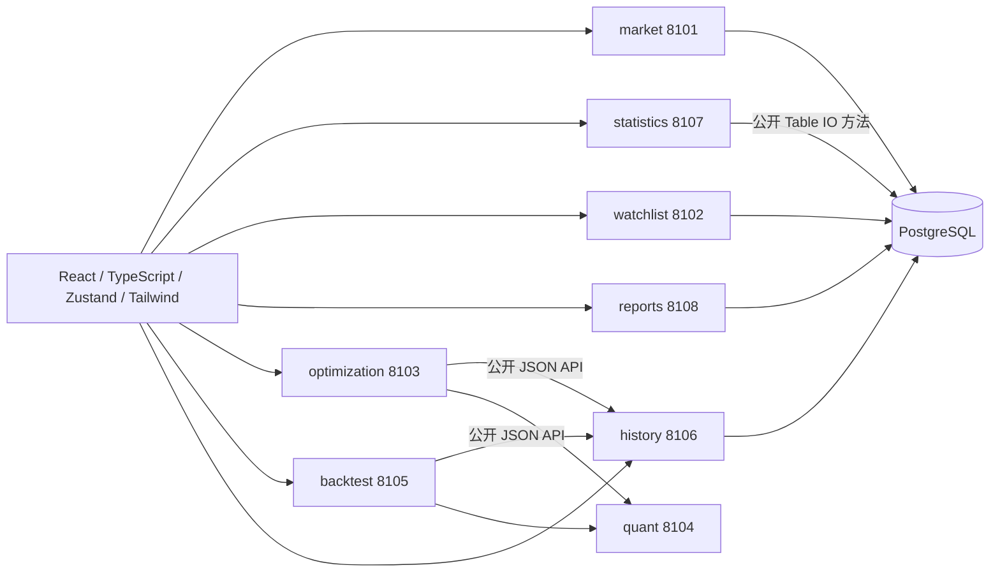

# 课程与示例实现对照

核对资料：lec2–lec5、用户重新上传且与原件 SHA256 相同的 samples.zip（samples/rules.txt、嵌套 sample.zip 的 backend-sample 与 frontend-sample）。附件中的安装命令与密钥说明仅为资料，没有执行。

## 八个独立进程的服务边界

| 服务 | 默认端口 | 职责 | 公开业务消息 | 持久化维护责任 |
|---|---:|---|---|---|
| market | 8101 | 证券目录、末日行情目录、数据来源 | ListStocksMessage | StockTable |
| history | 8106 | 历史 OHLCV 查询、批量价格 | GetPricesMessage | DailyBarTable |
| statistics | 8107 | 个股风险收益、年度统计 | GetStockMessage | 无私有表；调用公开 StockTable/DailyBarTable |
| watchlist | 8102 | 自选证券 | ListWatchlistMessage / SetWatchlistMessage | WatchlistTable |
| reports | 8108 | 参数与分析结果的保存、查询和删除 | SaveReportMessage / ListReportsMessage / DeleteReportMessage | ReportTable |
| optimization | 8103 | 五模型优化请求编排 | RunAnalysisMessage | 无私有表；HTTP 调用 history 与 quant |
| backtest | 8105 | 滚动样本外回测编排 | RunBacktestMessage | 无私有表；HTTP 调用 history 与 quant |
| quant | 8104 | NumPy/SciPy 优化与回测计算 | /analyze、/backtest | 无数据库访问 |

七个 Scala 服务共用一个可发布 JAR，但分别启动为独立 JVM、端口、路由与日志；并非只在同一进程内命名成多个组件。Python 为辅助数值服务，没有替代 Scala 业务后端。每个服务可通过 SERVICE、HTTP_PORT 单独运行。

## 课件要求的实际落点

| 来源 | 实现与可检查文件 |
|---|---|
| lec2：声明式与不可变集合 | `services/statistics/utils/Statistics.scala` 使用 val、map、sliding、groupBy、scanLeft；前端过滤、指标与图表是核心状态的派生数据 |
| lec3：领域对象与模式匹配 | Stock、DailyBar、ResearchReport、AnalysisParameters 及响应各自独立文件；final case class 与伴生对象派生 Circe 编解码；Main 按服务模式匹配 |
| lec3：Monad、纯函数与副作用 | Scala API 统一 `plan(connection): IO[Response]`；JDBC、文件、HTTP 在 IO/Resource 边界；纯 Statistics 不读写数据库；没有业务 unsafeRunSync |
| lec4：高内聚服务与 API | 上述八进程；`services/<owner>/api|objects|routes|tables|utils` 明确归属；一个消息一个文件、一个服务一个 Routes 注册表 |
| lec4：JSON 序列化 | Circe Decoder/Encoder；统一根据 Message 类名推导路由；每个服务有 `/api/<service>/openapi.json` |
| lec4：数据库与关系 | 股票主键、日线复合主键和外键、报告 UUID；每张表有独立 Table / Initializer；SQL 与参数绑定封装在所属 Table |
| lec5：React/TypeScript、跨页状态 | 六个业务页面；Zustand 的私有 store 通过小接口共享证券、自选与组合；局部参数/筛选归属页面 |
| lec5：模块化与 useEffect | useStock/useUniverse/useExperiment 分离 API 副作用；字段设置、规则编辑、行情表、联动图分别为组件文件；AbortController 清理请求 |
| lec5：Tailwind/Flex/Grid/Vite | 组件内 Tailwind utility；复用终端类通过 @apply 组织 Flex/Grid、字体、颜色等；sticky 表头、视窗尺寸、ECharts 容器及媒体规则保留 CSS |

## 示例规则的落实与有意差异

- 规则 2–10、12：表维护责任属于上表所列服务；SQL 为私有字段，公开 Table 方法返回 IO。跨服务调用封装好的公开 Table 是示例明确允许的边界。私有工具对象使用 `private[statistics]` 等服务作用域，不让其他服务直接调用内部工具。
- 规则 13–18：领域对象只定义数据与序列化。UUID 在 IO 边界生成。系统 APIRegistration 是携带 IO 执行计划的平台注册数据，不是需要 Circe 序列化的领域对象。
- 规则 19–34：输入在 Message 构造字段，执行入口为 plan；路由器只负责解码、事务、执行与错误返回。OpenAPI 为系统基础设施。每个公开 Scala 消息都有同名、同服务的前端 API 类；自动契约测试检查二者一致。
- 规则 34–40：各表单独文件夹和 Initializer。数据库保留旧版 `market` / `portfolio` SQL schema 名称以保留既有自选与报告；逻辑维护责任已细分，不以改 schema 名字伪装服务拆分。采用同一 PostgreSQL 实例，与课件共享 Connection / 外键方式一致；未宣称物理分库。
- 规则 41–60：页面核心状态与派生数据区分，API/hook/组件/计算函数就近分文件。源数据不足显示 —；加载、失败、无结果与操作状态可区分。文档产物在 docs，不混入业务源码。
- Python 数值响应与来源审计含动态结构，Scala 保留 Json；前端有明确结果类型，真实 API 测试核对数值和字段，未生成无意义的转发层。
- 本地版无账户与权限系统，不接受未经验证的 userId；扩展多用户时必须另做账户服务与路由身份校验。
- lec2 的卡通 IP、循环视频与日记本是另一软件示范，本金融研究项目没有将其混入行情页面，也未声称完成那些媒体产物。

## 如何复查

1. 查看 `backend/src/main/scala/services/` 的七个业务文件夹及 system 基础设施。
2. 查看 `frontend/src/apis/<service>/<Message>.ts` 与同服务 Scala API 的对应关系。
3. 启动后分别访问八个 `/health`，七个 Scala 服务各自返回自己的服务标识。
4. 在数据中心访问各服务的 OpenAPI JSON；对照 `docs/API.md`。
5. 运行 Python API 契约检查、真实 HTTP 集成检查和浏览器完整流程；命令见 README。
