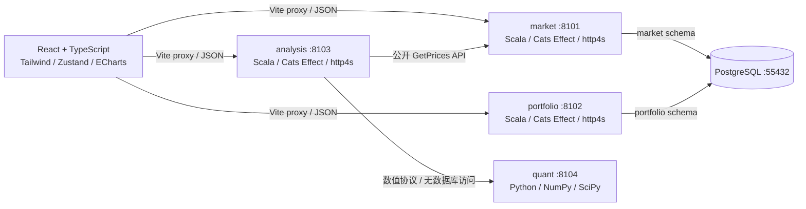

# 架构与课程要求对照

## 运行架构

课程参考示例使用 Scala 3、Cats Effect、http4s、Circe、PostgreSQL；这里保留业务后端的相同技术栈。Python 是数值优化的辅助微服务，不替代 Scala 的 API、表封装和业务组织。

## 对照表

| 课程内容 | 实现 | 查看位置 |
|---|---|---|
| lec2：声明式、不可变值、集合变换 | Scala 核心统计使用 `val`、`map`、`sliding`、`groupBy`、`scanLeft`；没有业务 `var` 或命令式 `for` 循环 | `services/market/utils/Statistics.scala` |
| lec3：case class、Option、模式匹配、纯函数 | Stock/DailyBar/响应类型是 case class，查询用 Option，服务入口模式匹配；统计与图表数据变换不做 I/O | `objects/`、`utils/Statistics.scala`、前端 `functions/` |
| lec3：副作用推到边缘、IO 组合 | API `plan(connection): IO[Response]`，数据库和文件读写在 `IO.blocking` 中，外部 HTTP 也在 IO 中 | `services/*/api`、`services/system/Database.scala` |
| lec3：Cats Effect | Resource 管连接与服务器，IO 组合步骤，框架在程序边缘执行；无业务 `unsafeRunSync` | `Main.scala`、`APIMessageRouter.scala` |
| lec4：服务高内聚低耦合 | 行情、研究记录、分析、数值分别部署进程；HTTP 公开契约，数值服务无数据库权限依赖 | `scripts/start-services.sh`、服务目录 |
| lec4：API 与序列化 | 每个 API 一个 Message 文件，Circe Decoder/Encoder，统一消息注册路由 | `services/*/routes`、`services/system/api` |
| lec4：数据库、主键与关系 | 股票主键、日线复合主键与外键；报告 UUID；每张表独立定义和初始化 | `services/*/tables/*Table` |
| lec5：React + TypeScript | 严格类型检查，函数组件，页面按业务区域拆分 | `frontend/src/pages/` |
| lec5：核心与派生数据 | 核心状态为筛选、选股、参数；股票过滤、指标和图表为派生数据 | Overview/Stock hooks、`functions/charts.ts` |
| lec5：Zustand | 跨页共享已载入股票、自选、组合标的、当前股票；私有 store 对外只暴露小接口 | `frontend/src/stores/research.ts` |
| lec5：Hooks 与副作用 | useStock/useExperiment 管理加载与错误，AbortController 清理请求；纯图表构造不使用 hook | `pages/*/hooks`、`pages/shared/hooks` |
| lec5：CSS、Flex/Grid、Tailwind、Vite | Tailwind utility 为主；CSS 只含主题和复用基础样式，Grid/Flex 自适应布局 | `frontend/src/index.css`、`vite.config.ts` |

## samples/rules.txt 的关键规范

- 业务服务集中到 `services/<service>/api|objects|routes|tables|utils`。共享基础设施归属 `services/system`；额外 `system/api` 是通用消息协议，不是业务薄转发层。
- 每张表单独目录，`XXTable.scala` 封装私有 SQL 和公开 `IO[T]` 方法；`XXTableInitializer.scala` 管建表与初始化。业务 API 不取得 SQL 后自行执行。
- API 输入为消息构造参数，以 `plan(connection)` 为执行入口；读写数据库和其他调用步骤可见，没有只做转发的额外 Service 层。
- 前端 API 调用文件与后端公开 Message 一一对应，路由名统一移除 `Message` 后转小写。生产构建保留类名，浏览器测试验证生产版本路由仍然正确。
- 前端按页面就近组织 hooks/functions/components；复杂量化页面入口只展示参数、保存区与结果区，结果按业务面板组织。
- 对象层保持数据定义；随机 UUID 在 API 的 IO 边界生成，未塞入数据对象。
- utils 保持 `private[market]` / `private[analysis]`。文件、数据库游标的局部可变资源仅限 I/O 边界，不将 JDBC 的命令式细节放入纯计算。
- 传输用响应类型放在 `objects/apiTypes/`；Python 的数值结果和动态来源元数据保留为 JSON，前端有明确 TypeScript 类型。数值协议在集成测试中校验。
- 本地研究版没有鉴权，不接受“用户自报 ID 当可信身份”的设计；如扩展多用户，需要新增账户服务并在路由边界验证令牌。

## 与课件示例的区别

领域是金融研究，不是复制图书借阅页面。未使用教学系统示例的 Kafka/Redis/MinIO，因为第一版不需要这些依赖。独立 Python 数值服务使用 NumPy/SciPy 保证矩阵与约束优化能力；业务编排与持久化继续使用课程要求的 Scala。

lec2 的卡通 IP、循环视频、两页面日记本是课件列出的第一次作业示范，未视为本金融终端的独立需求；这里落实的是金融终端所需的课程编程和架构内容。若评分表另要求这些媒体产物，应另按具体题目补充。
