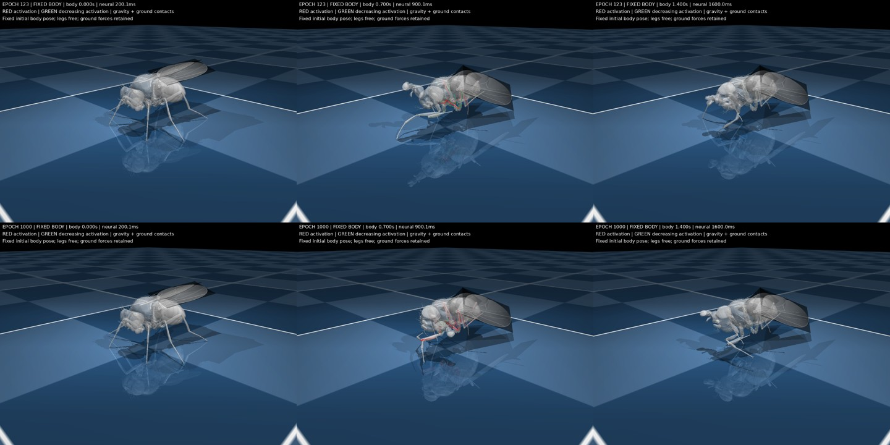

# Epoch 123 versus epoch 1000: actual fixed-body replay

This is a new full-network rerun, not the training surrogate or archived AB control replay. Epoch 123 uses `best_raw` from the immutable completed optimizer checkpoint; epoch 1000 uses `raw` from the same file. They are asserted distinct. The former is additionally checked against the previously independently validated full parameter matrix. Parameters are model fits, not measured physiology.

The source checkpoint SHA-256 is `44304aa747c7078755cb16720d39a32ec839cc5e4953b47fcb3bf2fbd888fe70`. The unchanged base YAML SHA-256 is `858d1818b8d8394c95bb62a6ce60474cb534a83b94265ef8615e367c110d262c`. Shared factors are exactly `0.2*tanh(raw)` on archived fields `[5,7,8,11,12,13,14,15,16]`, applied by the original group key to the entire network.

Both conditions use the original full hard-spike HH network, identical DN_drive events and initial conditions, and fixed physical body root with native leg, gravity, friction and ground contacts. No imposed anti-phase, target replay, rescue force, or sensory feedback is added. Videos are five-times slow playback. The accompanying circuit rendering is a schematic, not EM geometry. Red/green central edges mean excitation/inhibition; green muscles mean decreasing activation, not an inhibitory NMJ.

Run `python research/single-model-delivery-20261115/build.py`, download the two pinned ZIPs named in `render_checkpoints.py` from the existing training Release into `cache/`, then run `python research/bptt123-1000-videos-20261116/render_checkpoints.py` with the pinned runtime requirements installed and EGL available. The GitHub Actions workflow performs these same commands and uploads results to the existing public fixed-body video Release, leaving the training draft unchanged. Generated data are excluded from Git and backed up as Release assets with hashes, software versions and the source revision in the manifest.

Status: completed and independently checked. [GitHub Actions run](https://github.com/linzhefeng24/Applepie/actions/runs/43785410546) succeeded. All downloaded asset SHA-256 values match the remote manifest; epoch 123 spikes exactly reproduce the prior full-network validation, and both epochs produce distinct spikes, muscle excitation, activation, and body trajectories. Both roots have zero positional drift and nonzero native ground contact forces. See `delivery-review.json` for immutable identities, versions and links. Neither checkpoint is claimed to achieve free walking or correct left/right alternation. Epoch 1000 is the last state, not the best state.

## Download

- [Epoch 123 fixed body](https://github.com/linzhefeng24/Applepie/releases/download/fixed-body-video-20261115/BPTT_Epoch123_FixedBody.mp4)
- [Epoch 1000 fixed body](https://github.com/linzhefeng24/Applepie/releases/download/fixed-body-video-20261115/BPTT_Epoch1000_FixedBody.mp4)
- [Synchronized side-by-side comparison](https://github.com/linzhefeng24/Applepie/releases/download/fixed-body-video-20261115/BPTT_Epoch123_vs_1000.mp4)
- [All videos, including both neural circuit renders](https://github.com/linzhefeng24/Applepie/releases/download/fixed-body-video-20261115/BPTT_Epoch123_1000_Videos.zip)
- [Full recorded states and resolved parameter arrays](https://github.com/linzhefeng24/Applepie/releases/download/fixed-body-video-20261115/BPTT_Epoch123_1000_State.zip)

