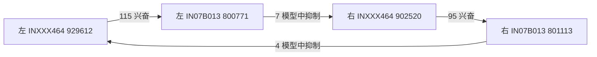

# 与左右交替直接相关的具体接线

目标：周期平均平衡、瞬时交替。只检查两条已定位后腿伸肌链，未统计全图均值或左右总量。

数字均为原始连接突触计数，不是手调电导；兴奋/抑制是当前模型符号。Glu抑制需受体证据支持。

| 连接 | 终点左后腿链 | 终点右后腿链 |
|---|---|---|
| DN_to_IN17 | 10056→800003：140 | 10045→800114：121 |
| IN17_to_INXXX464 | 800003→929612：61 | 800114→902520：69 |
| INXXX464_feedback_to_IN17 | 929612→800003：205 | 902520→800114：256 |
| INXXX464_to_MN | 929612→800621：38 | 902520→800158：101 |
| DN_direct_to_MN | 10056→800621：8 | 10045→800158：58 |
| E_to_cross_inhibitor | 929612→800771：115 | 902520→801113：95 |
| cross_inhibitor_to_other_E | 800771→902520：7 | 801113→929612：4 |

## 交叉抑制候选

两枚IN07B013预测为glutamate，抑制符号为当前模型受体假设。实际记录中左218/232ms、右221/235ms均发放：交叉支路有活动，但未形成半周期交替。

## 另外两点直接相关的接线

- 两枚DNg100（10045/10056）相互兴奋，各119个突触。它是共同活动的候选促进结构，未经单独切边验证。
- 右IN17A001 800114→IN14B005 801356（8）→左IN17A001 800003（4，模型中抑制）；选定细胞的这次两步检查未找到反向镜像支路。这不等于完整生物连接组没有更长或未提取的对应路径。

结论：两侧局部框架相似，但突触计数和部分具体路由不镜像。已有可研究的交叉抑制结构；当前实际活动仍接近同步，不能把结构存在当作交替已发生。
