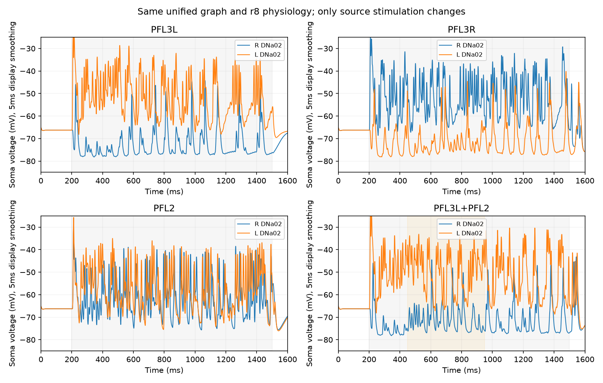
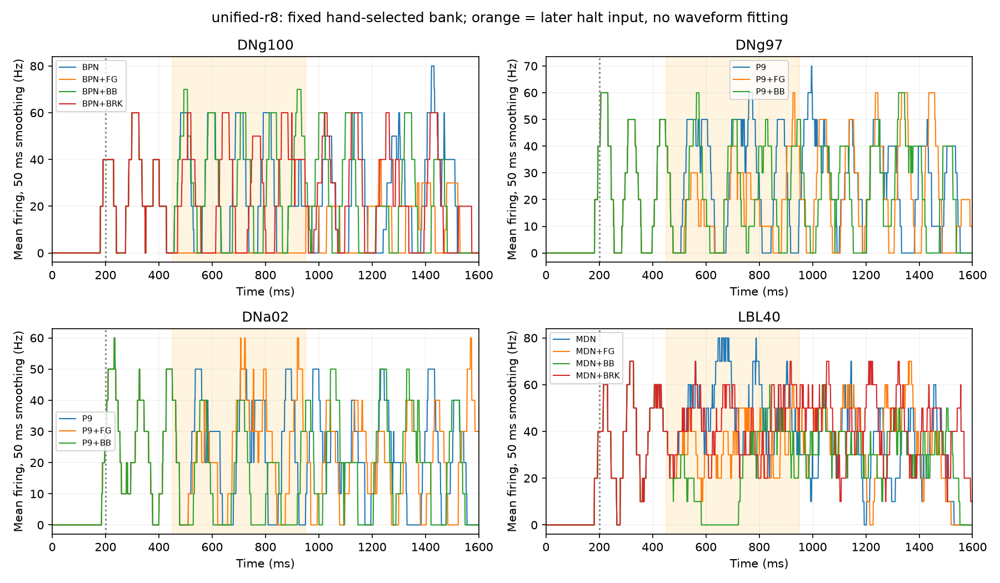
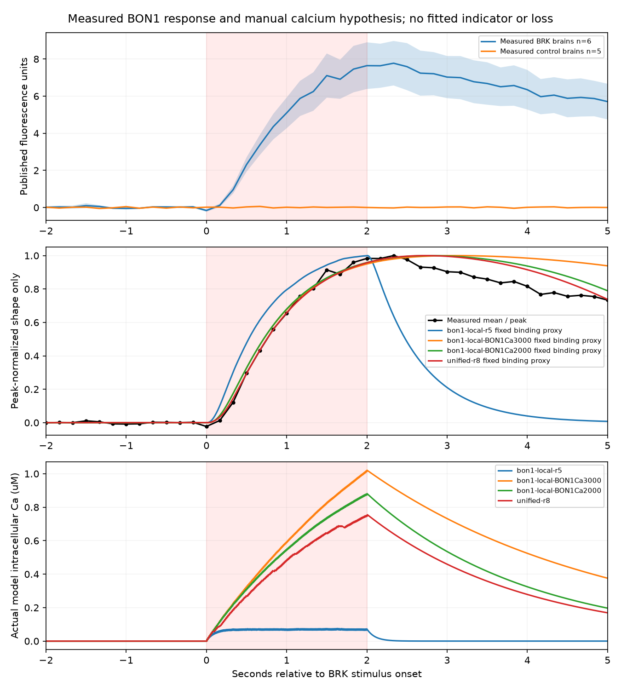

# 手动调参与同图复查：2026-11-15

这是新实现和实际重跑的记录。旧聊天中的8/8扰动保留率、0.446轨迹误差不作为本轮恢复成果。按完整电压、脉冲、钙和突触电流检查通路，再手动修改共享参数；没有按损失排序选解。

## 当前结果

MaleCNS统一图包含3474个神经元、455231条赋予兴奋／抑制符号的连接。原两张裁剪图的有符号及无符号子矩阵均逐项保留，跨回路边从原始表重新提取。它仍是裁剪网络。

同一套[r8参数](configs/manual-neural-bank-r8.json)已完成18个条件，均未出现数值失稳。下面的Hz是模型输出，不是实测目标值；短窗均值只用于说明，完整时间轨迹均已保存。

| 现象／关系 | 当前观察 | 证据与边界 |
|---|---|---|
| 左右DNa02相反响应 | 左PFL3输入：左／右约49／7Hz；右输入时约7／49Hz；低响应侧胞体超极化 | 与实验相反响应定性一致；不等于复制完整记录条件 |
| PFL2双侧募集和增益 | 单独输入募集双侧DNa02；加入左PFL3时同侧响应略升、方向保留 | 解剖／模型关系；增益效应仍弱 |
| BRK→BON1 | 2秒刺激招募双侧BON1；保留刺激后数秒的响应趋势 | 对照论文原始荧光数据；观测模型未标定，不能唯一确定生理参数 |
| MDN→LBL40 | 双侧募集；加入FG／BB后仍有输出 | 实验响应方向及行为的神经代理；原MF成像用了20秒刺激，短MDN探针不是完整复现 |
| FG／BB对BPN的差别 | DNg100约27／27Hz；FG脉冲时0／0，BB时约31／31；撤除后恢复 | 论文DN层结果含模型预测；不能据此直接宣布行为停止 |
| BRK与BPN | BRK脉冲保留DNg100活动，同时募集BON1 | 减轻了先前过强的脑内压制；未复现负载／支撑相刹车 |
| P9停止通路 | FG对oDN1作用有所增强；BB广泛抑制仍不足，BRK的P9效应也偏弱 | 尚未解决，不计为通过 |

## 实验时间曲线上的手动调整

论文BON1荧光在2秒BRK刺激结束后仍持续数秒。100ms钙清除先验恢复太快；手调3000ms又过慢，改为2000ms后，上升和拖尾形状更接近。相同的未标定GCaMP占据／结合假设始终固定，没有拟合荧光增益、任意时间曲线或损失。

局部候选放回统一回路后保留了这一趋势。下图红线为统一图结果。峰值归一化只比较形状，不能证明绝对荧光、真实钙浓度或唯一的钙清除时间。

## 节律到肌肉的因果检查

另一个MANC区域图有2553个细胞，包含337个MN；它不是与上述MaleCNS图拼接的同一只动物全链模型。

E1消融暴露出右前腿伸肌MN11706的DNg100直连旁路：其余抽查细胞已静默，它仍持续放电。实际剩余兴奋源为DNg10010339，解剖计数33。将共享的DNg100→胫节伸肌有效电导改为0.2，保留真实边和解剖计数。

该共享通路参数使早先右中／后腿逐细胞0.3增益调整不再必要。新的[共享运动端候选](configs/manual-motor-bank-shared-r1.json)没有逐细胞参数覆盖：

- 完整网络：抽查的六腿12个胫节MN均有活动。
- E1消融：12/12静默；全体337个MN中有活动者195→11。剩余11个主要表现为持续放电，不能将抽查结果推广成全网静默。
- E2消融：仍有大量下游活动，完整消融／节律约束尚未解决。

这里只将实际MN脉冲经共同滤波转换为u(t)。拮抗肌共激活、部分过强输出及映射缺口仍在，没有宣称正确步态或身体行走。

## 保留的失败与限制

r6/r7靶端受体增益试验改善了一些BB响应，却削弱FG／oDN1差别，未纳入主候选。LUL130候选家族的全段K0.9、共同轴突偏置等失败均保留。T3特异K0.8增强了候选家族的T3钙响应，但MF09精确EM身份和成像协议仍未核实，未纳入主候选。

MF14=LUL152已核实，但具体EM细胞未对应；chief9A→hook／claw的突触前机制、步相依赖、饥饿／糖感觉状态、Rdl行为效应仍未复现。程序提供受体干预能力不等于复现这些实验。不能说brain.json大部分现象已通过。

模型仍是约化双区室HH／Ca／SK，许多主动通道与突触参数未经成年目标细胞标定。成年MN漏电校准不等于完整成年生理。谷氨酸抑制符号仍含受体假设，单胺调制及感觉反馈尚不完整。

## 核对与复跑

23项回归检查通过。步长减半的单侧转向检查保留响应方向；局部BON1钙峰变化不足1%。这不是全网定量收敛或全部参数鲁棒性证明。

[逐项现象状态](brain.json)见`manual_joint_review_20261115`；[复跑说明](REPLAY_MANUAL.md)；[因果检查](results/manual-mechanism/shared-motor-readout-review.json)；[数值核对](results/manual-numerical-checks.json)。

四份大型公开输入共606774958字节，已备份到GitHub草稿Release并重新核对SHA-256及大小，见[资产清单](data/public-input-release-verified.json)。代码、参数、失败结果和来源均在仓库保存。
