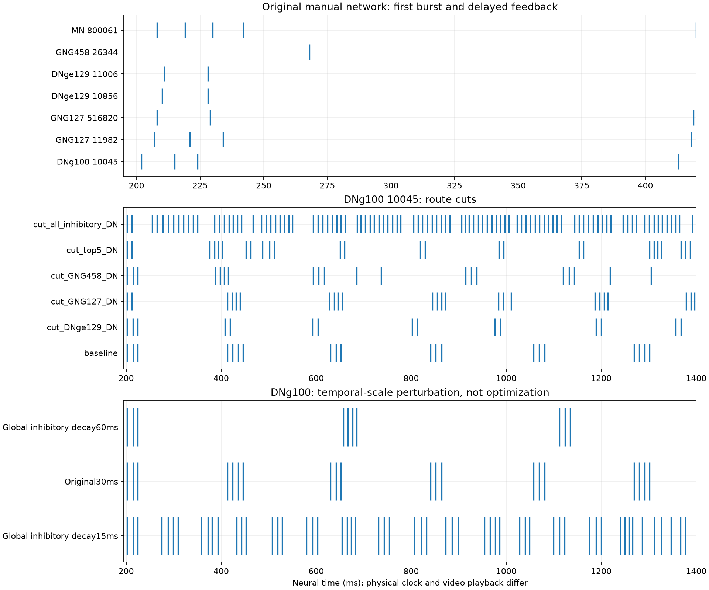

# 手调模型的DN周期活动：具体细胞与因果干预

完成18次全网络干预、6个未拟合小回路重构。原手调模型文件和参数、已发布视频均未改变；未重启训练。所有干预从初始神经状态重算1600ms，相同DN刺激和求解器。详细脉冲时间、边删除数、数据哈希见各JSON和summary.json。

## 确认的机制与定位边界

外加给DNg100（10045/10056）的刺激是200–1500ms恒定160pA。原网络中10045的簇起点为202、413、630、841、1058、1269ms，间隔约211–217ms。切去**所有615条进入两侧DN的抑制连接**后，10045在200–1400ms仍发102次脉冲，但最大ISI降为44ms，原本约190ms的长静默消失。因此原慢簇发依赖DN端反馈抑制，不是预先写入的周期刺激。

具体五个活跃反馈细胞如下，均为该模型中的GABA能抑制输出：

| 细胞类型／MaleCNS ID | 首轮放电时刻（神经ms，刺激200ms起） | 直接到DN的作用与干预结果 |
|---|---|---|
| DNge12911006（左） | 211、228 | 抑制两侧DN；单独切断其到DN的边，DN仍成簇但时序改变 |
| DNge12910856（右） | 210、228 | 同上；与11006成对切断或整对沉默也未消除全部簇 |
| GNG12711982（右） | 207、221、234 | 抑制两侧DN；单独/成对切断及整对沉默改变时序但不完全消除 |
| GNG127516820（左） | 208、229 | 同上；单独切断还可出现额外簇，不能简单解释为频率统一增减 |
| GNG45826344（右） | 268 | 延迟的抑制反馈；切到DN的边后第二簇从413提前至388ms，后续不规则；全细胞沉默也改变时序 |

DNg100直接兴奋DNge129和GNG127，后两类抑制回到DN。26344对DN有直接抑制，但DNg100→26344不能画成已确认的直接兴奋边；本次列出了活跃的两跳候选通路，尚未逐中继消融。

**不能把上述任意单个细胞叫唯一“起搏细胞”。** 五个细胞的反馈全部切断后，DN仍有其他回路支持成簇；只保留这五个的抑制输入也不能恢复原先规则210ms节奏。原节律依赖分布式反馈，既有冗余也有相互调节。此次已定位具体参与者和必要的反馈类别，未找到一个必要且足以重现原节律的唯一神经元/最小回路。

## 为什么会周期性恢复

记录显示DN放电之后招募反馈抑制；抑制积累后出现静默，随突触状态衰减再恢复放电。原模型的抑制电导衰减参数为30ms。保持其余参数不变、将全局该参数改为60ms，DN簇起点变成202、657、1112ms，稳定间隔455ms；改15ms后最大ISI55ms，原先长静默消失，但仍有较快的时间调制，不能说所有节律都消失。

该时间常数实验支持抑制恢复决定慢时间尺度，但改的是全局抑制突触，不是仅DN靶突触；不能据此断言哪个单独受体决定全部周期。这是模型诊断，参数未写回原手调模型。

## 对“小回路”的检查

保留真实连接和参数、只取DN与候选细胞作回路重构：有些产生瞬态或约100ms的簇，有些转为持续放电，均不能精确恢复原210ms节律。`DN_only`小回路仍保留两侧DN间的直接连接，不等同于上一轮“删除所有连接”的两个孤立DN，因此放电计数可不同。

## 复现与数据

1. 下载[原手调完整包](https://github.com/linzhefeng24/Applepie/releases/download/manual-r2-freebody-20261119/Manual_R2_FreeBody_Complete.zip)，SHA256为plan.json所列。
2. 将解压的Manual_FreeBody放在 `research/manual-full-rerun-20261119/cache/extracted/Manual_FreeBody`（experiment.py中的P），用包声明的软件环境。
3. 运行 `python research/dn-rhythm-localization-20261119/experiment.py cut_DNge129_DN`，其他case名称见CASES；`minimal_circuits.py`执行6个小回路。
4. `cache/*.npz`为每次完整脉冲矩阵及13个目标细胞的膜电位/电流，输出身份已记录。`summary.json`保留全部原始时刻，不靠单一频率指标作判定。

