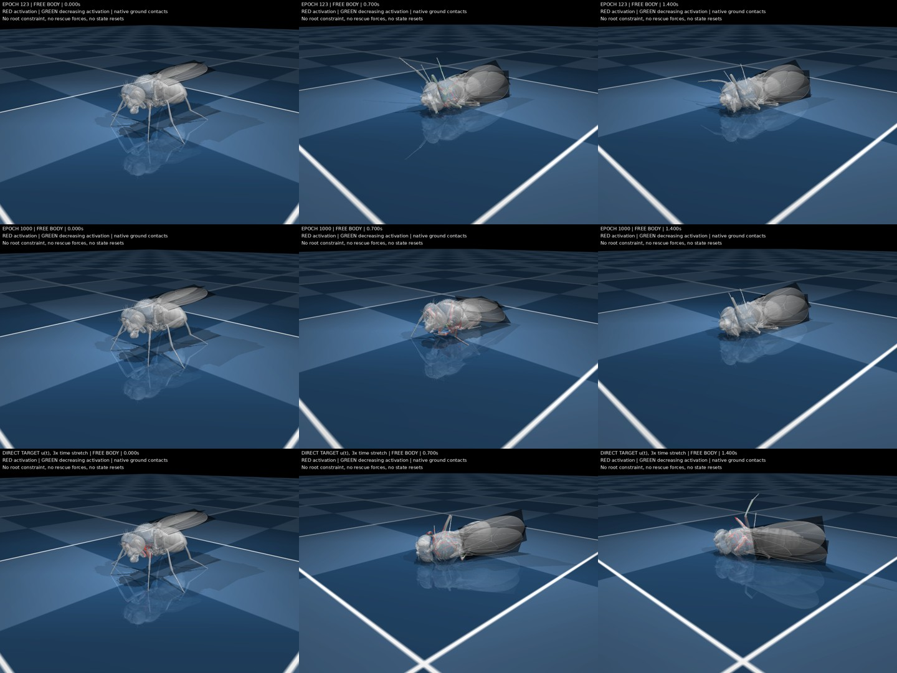

# Free-body comparison with direct target u(t)

> Native AB comparisons now use [the restored original AB protocol](../restore-native-AB-20261116/README.md). These earlier videos used modified initial state/neutral auxiliary controls and are retained for provenance, not as an original AB baseline.

Three new body simulations: epoch123 neural output, epoch1000 neural output, and direct replay of the exact old-A training target u(t). All use the same current 130-channel body YAML, free root, identical initial qpos/qvel/activation, native gravity/friction/contact, 1.4s physical duration and 5x slow playback. No root stabilization, resets, rescue forces or sensory feedback. Neural states are reused exactly from the verified full-network runs because this model has no body-to-neural feedback. They are not newly fitted or generated target signals.

Direct replay uses target_u (not target_a) with the same global training time mapping `(neural_ms-200)/3`, holds the last target after 1.2s body time, and applies all130 channels. The neural conditions retain 104 candidate-mapped channels plus26 mapping gaps. Target replay on this current model/initial state is not a reproduction of the older successful AB body simulation. This comparison does not establish free walking or experimentally correct alternation.

Run the existing single-model `build.py`, download `BPTT_Epoch123_1000_State.zip` into `cache/` from the existing public fixed-body Release, install the pinned runtime requirements with EGL, and run `python research/free-body-target-comparison-20261116/render.py`. Input hashes are enforced. Each case saves input u(t), initial state, body states, physical contacts, an MP4, and a report; the bundle and manifest include versions, code revision and immutable hashes. The GitHub workflow independently executes these commands and saves assets to the existing Release.

Completed: [independent GitHub run](https://github.com/linzhefeng24/Applepie/actions/runs/43808803831). All remote asset hashes verified after downloading; every public video/bundle link returned HTTP200 without authentication. Initial states match exactly. Neural muscle requests exactly match their fixed-body runs. Every time axis is monotonic and reaches1.4s; no extra forces or resets were observed. Logs contain no MuJoCo instability warning. See `delivery-review.json` for identities, hashes, software versions and measured states.

Visual result: both neural conditions sink and tilt substantially; direct target_u also becomes unstable and overturns under these current-model initial conditions and the training's3x time stretch. This does not establish failure of the historical native-speed AB replay. No stable free walking was reproduced in these three cases.

- [Side-by-side: epoch123, epoch1000, direct target_u](https://github.com/linzhefeng24/Applepie/releases/download/fixed-body-video-20261115/FreeBody_Comparison.mp4)
- [Epoch123](https://github.com/linzhefeng24/Applepie/releases/download/fixed-body-video-20261115/FreeBody_Epoch123.mp4)
- [Epoch1000](https://github.com/linzhefeng24/Applepie/releases/download/fixed-body-video-20261115/FreeBody_Epoch1000.mp4)
- [Direct target u(t)](https://github.com/linzhefeng24/Applepie/releases/download/fixed-body-video-20261115/FreeBody_TargetU.mp4)
- [Videos, exact inputs, body states and report ZIP](https://github.com/linzhefeng24/Applepie/releases/download/fixed-body-video-20261115/FreeBody_Comparison_Bundle.zip)

