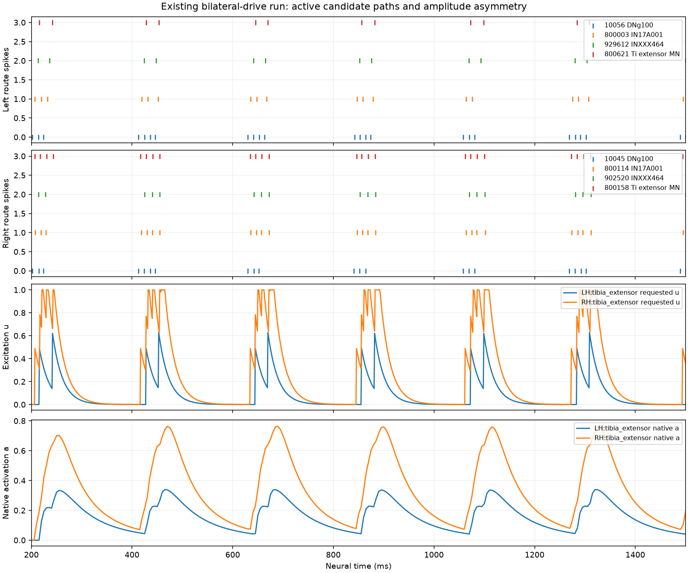

# 左右肌肉输出：候选活动链与两次单细胞探查

## 条件与观察范围

同一个MaleCNS3988/R2模型、同一个DNg100恒流协议，无优化、无新参数、无外加相位。统计窗400–1450ms。左右按终点后腿命名，源DN可跨侧投射。

候选链：

- 左后腿：DNg100 10056 → IN17A001 800003 → INXXX464 929612 → MN800621（同池812953）→ LH胫节伸肌。
- 右后腿：DNg100 10045 → IN17A001 800114 → INXXX464 902520 → MN800158（同池809935）→ RH胫节伸肌。

路径连接存在，各节点有实际活动；这尚不证明主要因果通路或局部CPG源。肌肉对应仍是候选映射。

## 实际结果

| 条件 | 左后腿伸肌平均u | 右后腿伸肌平均u | DN实际脉冲与基线一致 |
|---|---:|---:|---|
| baseline | 0.0952 | 0.2731 | True |
| silence_left_INXXX464 | 0.1081 | 0.3286 | False |
| silence_right_INXXX464 | 0.1185 | 0.2963 | False |

基线真实MuJoCo肌肉平均激活a：左0.1660，右0.3538。该值来自固定躯干、保留地面接触的实际身体回放。

## 结论

- 当前网络确实驱动左右同名肌肉出现幅度不对称；不是仅动画颜色不同。
- 波包主要仍同时起落；尚未建立左右反相交替，不能把强弱差当作交替步相。
- 两枚INXXX464分别沉默后，下游没有消失，平均输出反而增加；DN实际放电也改变。不能把此链称为唯一、不可替代的主通路，也不能从全细胞干预分离单条边贡献。
- 新干预只重算了神经和u，没有为干预条件重新生成身体视频。原始基线的a是真实身体结果。
- report.json、原始小型npz、活动图、源代码及软件/哈希记录均保留；没有更新交付模型的参数。

