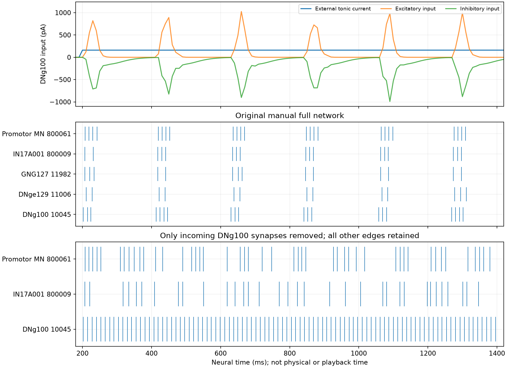

# 从头复算及DN节律来源核查

2026-11-19。从已发布完整包（约94MB，SHA256见provenance.json）重新解压，原封不动执行包内`run_manual.py --recompute-neural --render`。没有用旧神经数组初始化或驱动本次神经积分；原记录只在运行后用于比较，以及旧runner报告字段计算参考文件SHA。没有BPTT或参数优化，也未重启已停止的训练。

## 从头复算结果

- 3988个神经元从模型初态开始，完整积分1600ms，记录14908次脉冲。
- 所有神经记录数组（脉冲、膜电位、Ca、门控、突触电导和电流等）与交付包逐元素完全相等。
- 130路肌肉输入u(t)完全相等，最大差0。
- 连续自由身体积分4000步/0.4秒，完整关节位置、控制输入及记录状态完全相等；MSE0.11717840309739241rad²。
- 三份重新渲染的视频也逐字节一致。新神经NPZ SHA256亦与原文件相同。

因此大文件引用原Release资产，避免重复上传完全相同的数据；这不是略过重算。完整独立运行和逐数组比较已实际完成，见comparison.json、compare.py。仍限于同一软件环境的一次DN_drive协议，不是所有现象或长期行走的验证。

- [完整模型、手调参数、代码及相同结果](https://github.com/linzhefeng24/Applepie/releases/download/manual-r2-freebody-20261119/Manual_R2_FreeBody_Complete.zip)
- [与本次新渲染逐字节一致的同步视频](https://github.com/linzhefeng24/Applepie/releases/download/manual-r2-freebody-20261119/Manual_R2_Synchronized.mp4)

## 为什么神经图闪烁：外部电流、DN输出与网络反馈必须区分

实际输入只对DNg100的10045/10056号细胞，在神经时间200–1500ms施加恒定160pA；没有外部周期电流，也没有手工周期肌肉轨迹。完整网络内，DN自身却呈簇发：10045的簇起点约202、413、630、841、1058、1269ms（60ms仅是分开短/长间隙的分析阈值）。约211–217ms一簇，对应神经时钟4.7Hz；并非每个簇内动作电位的频率。IN17A001和部分MN随后出现相应簇。

这次进行了三项诊断（参数文件和发布手调模型均未改动）：

1. 从网络隔离两侧DN，保留原参数和160pA输入：各DN在200–1400ms发放94次，不再有原来的长静默间隔。这否定“单独的DN在这组参数下就能产生原慢簇发”。
2. 隔离DN再去掉SK，仅为辅助机制扰动：各96次，没有恢复原慢簇发；不能将原节律简单归因于DN的SK。
3. 保留整个网络，只删除进入两侧DNg100的边，其他边和所有神经参数不变：DN同样变成较连续94次放电，IN17A001与MN仍可出现非原来的规则簇。这说明原DN的约210ms慢簇依赖反馈；尚不能据此认定VNC没有独立节律机制。

具体反馈结构包括DNg100→DNge129(11006/10856)⊣DNg100，以及DNg100→GNG127(11982/516820)⊣DNg100。直接边与符号来自本模型已使用的连接和权重；原始记录也观察到这些GABA能细胞放电以及DN抑制电流。举例10045在230ms抑制输入约−710pA，外加电流仍160pA；到410ms抑制输入衰减至约−6pA。该时序与反馈抑制门控相符，但没有逐个消融确认上述每个细胞的必要性，不能宣称已定位唯一振荡源。记录及逐边信息见DN-feedback-paths.json。

结论：外部DN驱动是恒定的；在这个完整手调模型中，DN与回返网络共同产生慢簇发，DN输出再参与下游节律。当前不能把全图同步闪烁当成“已单独复现论文VNC局部CPG”的证据。

## 显示本身也会增强闪烁感

- 节点颜色取采样时刻的兴奋+抑制+外加电流，不是膜电位，也不是每帧是否发过脉冲。
- 连线红/绿标的是固定的模型兴奋/抑制符号，亮度和粗细随源神经元的20ms滤波放电率变化，不表示递质符号来回变。
- 神经积分步长0.0125ms；电流记录10ms一次；回放神经时钟为身体的3倍，相邻身体记录对应15ms神经时间；80帧、25fps视频还对时间采样和慢放。不能从屏幕闪烁直接读出生理频率。
- 肌肉绿色表示激活下降，不是抑制性NMJ。

