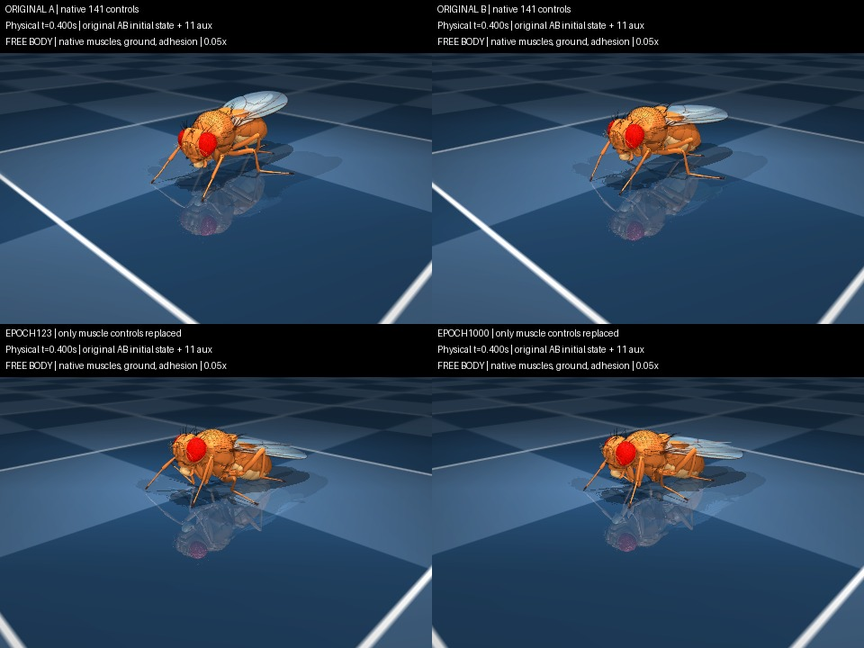

# Restore native successful AB and evaluate saved checkpoints on identical physics

Original A and B have been independently rerun at native0.4s: minimum body-up-z0.98891/0.96360, forward displacement1.412/1.219mm. This recovers the saved short replay; it does not establish long-term walking. See `original-replay-preflight.json`.

The previous free-body comparison zeroed original velocity/all actuator activations, omitted warmstart and the time-varying11 auxiliary controls (including six adhesion channels), and stretched the physical trajectory3x. Those outputs are retained as historical mismatched-condition experiments, not valid original-AB controls.

This experiment uses the archived `parameters.yaml` and `simulation.py` unchanged. It restores complete FULLPHYSICS state, original warmstart, native0.1ms integration, complete141 control arrays, gravity, free root and ground/contact/adhesion. A and B share exactly the same initial state, warmstart and auxiliary controls. Only130 muscle columns are replaced for neural candidates. Neither rescue forces nor missing muscle inputs are supplied from A to the neural conditions. Original A/B must exactly equal the archived replay method's entire saved state arrays and remain upright before videos are labelled restored.

The target used in training is verified elementwise identical to native A's130 muscle controls (identities in `config.json`). The existing checkpoints were trained on A only; B is an additional comparison. No checkpoint is relabelled B-trained, and no retraining is claimed. Training fitted u(t), with no body solver in the loss; the corrected body replay does not alter those parameter updates.

To retain the exact trained time correspondence while preserving original AB physics, replay uses `neural_ms = 200 + 3*physical_ms` over physical0–400ms. This compresses the saved neural-output clock, not the physical body/gravity/auxiliary clock. It is a declared global interface time warp, not a claim about native biological neural frequency. No end-of-trajectory hold is appended. Neural outputs are reused from the prior verified full hard-network runs; current model has no body-to-neural feedback.

Run `python replay_compare.py` after putting the pinned `FreeBody_Comparison_Bundle.zip` in `cache/` and installing the versions in `config.json`. The GitHub workflow runs the same experiment, packages the unchanged model, original simulator, precise neural inputs and complete result states/videos, and backs them up to the existing public video Release. The standalone ZIP includes `RUN.txt` with an offline reproduction command.

Video layout: upper-left originalA; upper-right originalB; lower-left epoch123; lower-right epoch1000. Physical duration0.4s, original0.05x playback. Completed: [GitHub run](https://github.com/linzhefeng24/Applepie/actions/runs/43811446167). Remote files were downloaded and SHA-256/byte counts verified. Every public video/bundle URL returned HTTP200 without authentication. The standalone bundle was extracted into a temporary folder and all four full physical state trajectories recomputed using only packaged files, with elementwise exact results (maximum difference0). It replays saved neural outputs; it does not retrain or rerun the full neural network offline. See `offline-reproduction-check.json` and `delivery-review.json`.

Original A/B final qpos also exactly match the pre-existing November15 historical records (`historical-recovery-check.json`), not merely another call to the new driver. Original model/simulator bytes remain unchanged. All cases share the exact complete initial state, warmstart and11 auxiliary schedules. Only130 muscle columns differ. The substituted exact A target reproduces original A full-state trajectories exactly.

| Condition | Forward displacement in0.4s (mm) | Minimum body-up-z |
|---|---:|---:|
| Original A |1.4121|0.98891|
| Original B |1.2190|0.96360|
| Epoch123 |−0.0811|0.95246|
| Epoch1000 |−0.1743|0.96382|

Both neural candidates remain upright over the restored0.4s, but fail to reproduce AB forward progression. Retained auxiliary adhesion/head/abdomen inputs are archived controls, not neural-generated outputs. This does not prove long-term stability, successful muscle fitting or neural walking. The all130 u-RMSE to A is0.5400/0.5468 for epoch123/1000, including26 unmapped channels.

- [Matched four-panel video](https://github.com/linzhefeng24/Applepie/releases/download/fixed-body-video-20261115/NativeAB_Comparison.mp4)
- [Restored original A](https://github.com/linzhefeng24/Applepie/releases/download/fixed-body-video-20261115/NativeAB_A.mp4)
- [Restored original B](https://github.com/linzhefeng24/Applepie/releases/download/fixed-body-video-20261115/NativeAB_B.mp4)
- [Epoch123 on original AB physics](https://github.com/linzhefeng24/Applepie/releases/download/fixed-body-video-20261115/NativeAB_Epoch123.mp4)
- [Epoch1000 on original AB physics](https://github.com/linzhefeng24/Applepie/releases/download/fixed-body-video-20261115/NativeAB_Epoch1000.mp4)
- [Offline physical replay bundle: model, original engine, precise inputs, states, videos and RUN.txt](https://github.com/linzhefeng24/Applepie/releases/download/fixed-body-video-20261115/NativeAB_Reproduction_Bundle.zip)

