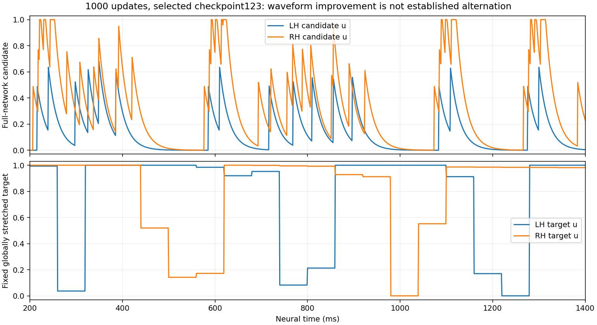

# 1000轮完成后的结果核对

真实完成1000次Adam参数更新，历史记录包含0至1000共1001个更新编号。最佳训练检查点为第123轮，后续更新没有提前停止。训练是260细胞的局部边界回放代理梯度BPTT，验证是原始3988细胞硬脉冲网络自由运行，两者不混称。

## 原始完整网络中的u拟合

| 项目 | 基线 | 候选 | MSE下降 |
|---|---:|---:|---:|
| 训练时段104映射通道 | 0.324034 | 0.303116 | 6.46% |
| 留出时段104映射通道 | 0.304485 | 0.298350 | 2.02% |
| 留出时段全部130通道，含26缺口 | 0.282295 | 0.277387 | 1.74% |

参数最大相对变化8.19%，共享变量的RMS变化4.60%，低于±20%限制。207个类型共享变量影响341枚细胞。没有更改解剖连接计数、递质符号、肌肉模型或读出映射。26个映射缺口没有被填补。

## 具体通路核对

- 无刺激全网0次放电。
- 左功能输出侧PFL3刺激时，DNa02左523769为53.33Hz、右10360为8.89Hz，同侧优势保留；不等于完整转向实验通过。
- BRK刺激时BON1候选39880/800041仍响应，分别60.00/62.22Hz；不是实验GCaMP波形的定量复现。
- BPN+FG协议中DNg100的FG时窗残余为6.67/4.44Hz，原R2同条件为2.22/2.22Hz，抑制变弱；不能把所有原有现象都记成改善。
- 后腿同名伸肌及IN07B013两侧记录仍有大量同时起落，例如IN07B013左218/233ms、右222/235ms。未建立稳定左右反相交替，不能把均值强弱差作为目标已达成。

这是对已上传原始结果的核验，不是重新训练或重新应用旧修改。候选未自动替换基线，也未发布新的Release。下载来源及SHA、逐细胞数据见summary.json和已保存的训练Release清单。

