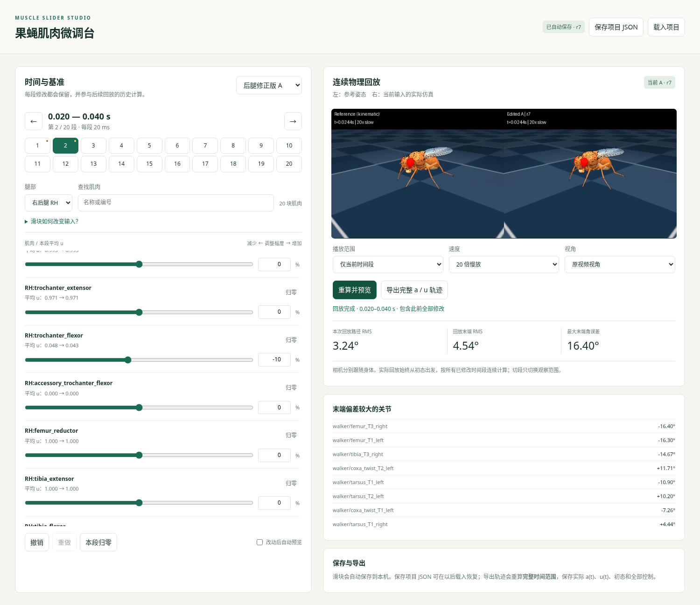

[下载完整程序 ZIP（约23 MB，含模型资源）](https://raw.githubusercontent.com/linzhefeng24/Applepie/main/tools/muscle_slider_studio_20261107.zip)



# 果蝇肌肉微调台

在浏览器中手工修改六条腿130块肌肉在各时间段的激励，连续物理回测、观看参考对比视频、保存项目及实际轨迹。包含原后腿修正版A/B和提前小幅迭代A/B的输入、对应模型和全部所需网格；运行时不需要另找服务器。

## Windows 启动

1. 安装 **Python 3.11 或 3.12**（python.org），安装时勾选Python启动器或加入PATH。
2. 解压程序到普通可写文件夹，双击 `start_windows.cmd`。
3. 首次会在程序目录创建独立环境、安装依赖，然后打开 `http://127.0.0.1:8765`。后续直接双击即可。运行时请保留命令窗口，关闭窗口会停止本机程序。

首次安装依赖需要联网。安装后，界面、仿真和数据均在本机；不会把编辑结果自动传到GitHub。需要显卡的正常OpenGL驱动。

Linux 可用 `bash start.sh`。也可在已装依赖的Python环境运行 `python server.py`。默认20ms一段；希望10ms分段时运行 `python server.py --segment-ms 10 --workspace user_data_10ms`，使用单独工作目录。不同分段的项目不能混载。

## 使用

1. 选择基准A/B；默认0–0.4秒、20段，每段20ms。
2. 选择时间段和腿部，拖动各肌肉滑块。百分比输入框支持更细的0.1%调整。
3. 自动预览默认开启；也可关闭后调整多块肌肉，再点“重算并预览”。可查看当前段、开头到本段末尾或完整轨迹；支持慢放与不同视角。
4. 切换到后面的时间段时，前面已改的输入继续参与仿真。边界处不重置姿态、速度或肌肉激活。
5. “保存项目JSON”下载可恢复编辑的项目；“载入项目”恢复所有肌肉、所有时间段。四个基准各自自动保存，互相切换不会丢失。
6. “导出完整a/u轨迹”重新计算完整0.4秒，生成ZIP，包括实际激活a的CSV、输入u的CSV、完整身体状态/141通道输入/初态/warmstart的NPZ及项目JSON。即使只在看第一段，导出仍覆盖完整范围。

## 滑块的精确定义

设基准在某个时刻的输入是 `u0(t)`，本段该肌肉滑块为 `s∈[-1,1]`：

```
s >= 0: u(t) = u0(t) + s * (1-u0(t))
s <  0: u(t) = u0(t) * (1+s)
```

因此+100%是整段u=1，−100%是整段u=0，0恢复本段基准。每个时刻单独应用公式，原段内的起伏被保留；不会把整段替换成一个常数。滑块是相对基准的绝对系数，所以从+20%拖到+30%得到30%余量调整，不会重复叠加。

**u不是实际激活a**。a由原模型的激活/去激活动力学计算，下一段起点的a来自此前连续仿真。这里不做自动优化，也没有增加高度/速度惩罚或救援力。

## 历史状态与保存位置

- `user_data/projects/`：每个基准的全部滑块，拖动后自动写入；通过临时文件替换，刷新或重启可恢复。修改后显示的版本号rN用于区分新输入与旧视频。
- `user_data/outputs/`：生成的视频和轨迹导出文件。
- 每次输入改变后，从原始完整初态和warmstart出发，按**全部已修改输入**连续计算到请求的终点。相同输入版本可复用已有结果；没有用未修改基准的段首状态来拼接新段。
- 回放异步生成，旧版本的结果不会冒充当前输入。完整范围视频可能需要几十秒；只看当前段较快。
- 导出ZIP中，a采样包含初态和末态；u每行作用于随后的0.1ms，不在终点额外定义一个控制区间。project.json保存滑块，不是a轨迹本身。

## 数据与限制

`data/manifest.json`记录基准和模型SHA-256、原始来源。模型仅重写了网格路径以便移动，未修改肌肉参数；准备数据时的物理等价性由测试核验。参考是先前的半速仿真轨迹，不是动物录像。当前模型仍有估计解剖参数；预设输入也没有保证正常或周期行走。

本程序主要面向Windows/Linux。MuJoCo和Python依赖版本在requirements.txt中固定；建议使用独立环境，避免与其他项目的包混用。
